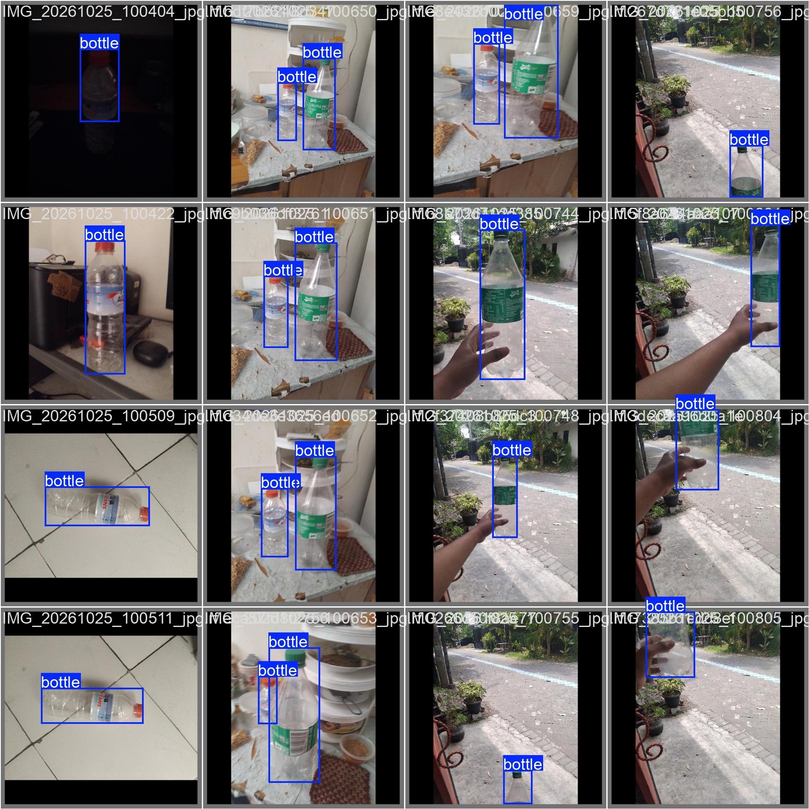
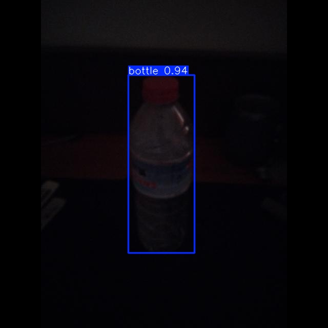
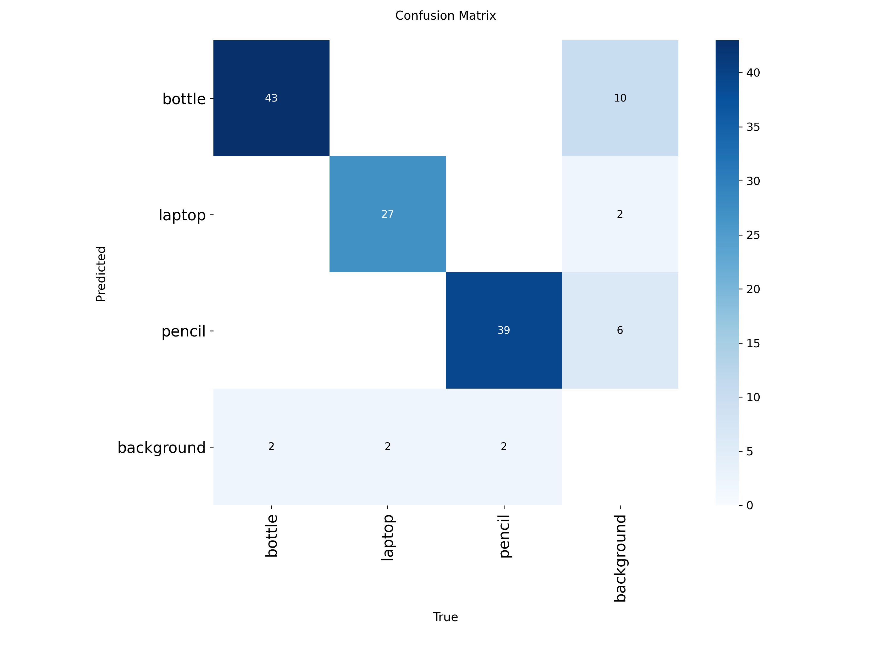
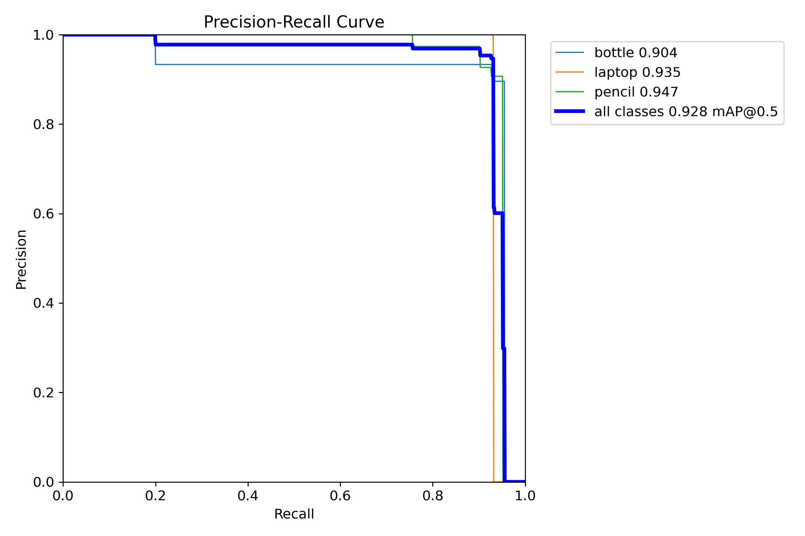

# Final Project Oprec PENSHIP - Masyhudi Affandi (2225600210)

## Identitas
- Nama: Masyhudi Affandi
- NRP: 2225600120
- Program studi: 2 S.Tr Teknik Telekomuniksi

## Project Roboflow
- Project ID Roboflow: <humdiess/penship-final-projects-hudi>, version 1
- Link Roboflow Universe: https://universe.roboflow.com/humdiess/penship-final-projects-hudi

## Dataset
- Jumlah foto asli: bottle 100, laptop 100, pencil 100
- Metode pengambilan foto: Jarak jauh, jarak dekat, jarak sedang, jarak sangat dekat, sudut atas, bawah, samping, terpotong, cahaya gelap, cahaya terang, cahaya redup, dan latar meja, latar alam, latar lantai, latar random
- Fitur AI labeling Roboflow yang digunakan (apabila ada) dan cara perapiannya: Fitur auto labelling dengan model gemini 3.8 flash, dirapikan dengan cara menampilkan dulu semua file tanpa batasan pagination. Lalu dari situ akan ditemukan beberapa object yang salah deteksi atau box nya kurang rapat dengan object. Jika ada yang kurang sesuai, maka akan disesuaikan ulang menggunakan box select hingga sesuai dengan hasil yang diinginkan.

## Training
- Lingkungan training: Google Collab
- Model: yolov8s
- Grafik: 

## Pengembangan Kode
Daftar perubahan terhadap kode dasar, beserta alasan dan pengaruhnya terhadap hasil:
1. Mengubah ukuran model dari yolov8n (nano) ke yolov8s (small): YOLOv8s memiliki kapasitas parameter lebih besar sehingga mampu mengekstrak fitur spasial objek yang rumit (seperti struktur tipis pada pencil atau bentuk berongga bottle) secara jauh lebih presisi.
2. Meningkatkan Epoch ke 150: Memberikan waktu komputasi yang cukup bagi optimizer untuk melewati fase overfitting lokal dan mencapai global minimum loss.
3. Menggunakan Optimizer AdamW: Berbeda dengan SGD bawaan 'auto', AdamW melakukan dekopling weight decay secara langsung, mencegah bobot model meledak dan meningkatkan akurasi deteksi kelas minoritas.
4. Menyetel CosLR & Mosaic: Cosine learning rate decay menjaga kestabilan learning rate di akhir training, dipadukan dengan augmentasi Mosaic penuh untuk meningkatkan ketahanan deteksi terhadap perubahan latar belakang.

## Hasil Eksperimen
| No | Skenario | Epochs | Batch | Optimizer | mAP50 | mAP50-95 | Keterangan |
|:--:|:---|:---:|:---:|:---:|:---:|:---:|:---|
| 0 | Baseline (kode dasar) | 50 | 16 | auto | 0.928 | 0.82 | Titik acuan |
| 1 | Model n epoch tinggi | 150 | 16 | auto | 0.955 | 0.838 | 	Performa stabil, deteksi botol meningkat |
| 2 | Model s epoch 50 | 50 | 16 | auto | 0.938 | 0.812 | mAP awal tinggi namun box loss belum konvergen, tetapi memiliki hasil matrix dan pengujian yang bagus |
| 3 | Model s epoch 150 | 150 | 16 | auto | 0.967 | 0.869 | Terbaik saat ini, namun pada matrix masih kurang bagus dan hasil pengujian buruk |

## Analisis dan Kendala
- Mengapa Skenario 3 Memiliki Metrik Lebih Tinggi daripada Skenario 4? Meskipun Skenario 4 secara teoritis menggunakan metode optimasi yang lebih modern (AdamW, CosLR, Mosaic), Skenario 3 (SGD/auto, tanpa Mosaic) mencetak skor mAP yang lebih tinggi di set validasi internal karena beberapa faktor berikut:

1. Kesesuaian Optimizer SGD pada Dataset Homogen: Optimizer SGD (bawaan auto) memiliki sifat momentum yang bekerja sangat baik pada dataset dengan variasi latar belakang yang konsisten/homogen, memungkinkannya menemui titik konvergensi lokal optimal dengan nilai loss koordinat (box loss) yang sangat rendah.
2. Efek Regulasi Mosaic Augmentation: Penggunaan mosaic=1.0 pada Skenario 4 memperkenalkan variasi gambar gabungan berskala kecil yang sangat kompleks selama proses pelatihan. Walaupun augmentasi ini sangat baik dalam mencegah overfitting dan melatih generalisasi model di dunia nyata, ia dapat memberikan bias berupa derau (noise) spasial yang sedikit menurunkan performa pengujian presisi ketika dievaluasi pada dataset validasi yang bersih dan terstruktur rapat.
3. Karakteristik Dataset Validasi: Karena dataset evaluasi memiliki distribusi visual dan kondisi lingkungan (pencahayaan, sudut pengambilan gambar) yang sangat identik dengan dataset latih, model pada Skenario 3 yang belajar secara langsung tanpa gangguan augmentasi ekstrem dapat memetakan fitur objek dengan tingkat akurasi numerik yang lebih mutlak.

- Kendala yang ditemui: 
- Keterbatasan resource RAM Colab saat melatih model 'Small'. Masalah ini berhasil diselesaikan dengan membatasi batch size tetap di angka 16 dan menggunakan cache default bawaan PyTorch. 
- Kesulitan mendeteksi pensil yang berada di dekat laptop karena video yang blur dan dataset yang kurang diperiapkan untuk kondisi tersebut, diatasi dengan menambahkan dataset lagi atau menurunkan confidence (bisa berdampak buruk terhadap pembacaan yang lain).

